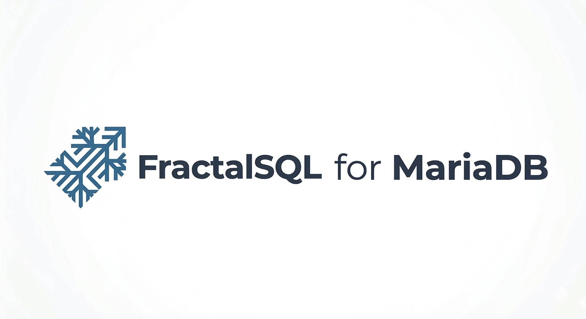

<p align="center">
  
</p>

# Discovery API Reference

The Discovery tier provides high-precision and diverse retrieval mechanisms. Unlike traditional vector search, it treats the embedding space as a continuous optimization problem.

`fractal_sfs_converge` covers two modes in **one** function: pass a non-empty corpus for top-k search, or pass an empty corpus (`''`) for pure Sniper-mode convergence, and set `"debug":true` in `params` for a trajectory trace.

For a convergence run that reports the trace with no corpus at all, use `fractal_sfs_converge_debug` -- the same search with the corpus removed and the trace always on.

> **Renamed.** The table-free convergence function was `fractal_search`; it is now **`fractal_sfs_converge`** (and `fractal_search_debug` is now `fractal_sfs_converge_debug`). There is **no alias**: the old call is refused with a message that names the new name. `fractal_search` now means the **indexed search over a table** (see "The native IVF index" below) -- it is a stored procedure, because a MariaDB UDF cannot read a table.

---

## `fractal_sfs_converge`
**Corpus top-k search, or pure Sniper-Mode convergence**

Runs Stochastic Fractal Search against an inline corpus and returns the top-`k` closest points by cosine distance, alongside the raw converged best point. Pass an empty corpus for the pure-convergence behavior — converge to the single best point in `[-1,1]^d`: `fractal_sfs_converge('', '[1,0]', 1, '{}')` returns a synthetic one-row result whose `top_k[0]` **is** the converged point.

### Signature
```sql
fractal_sfs_converge(
    vector_csv TEXT,   -- corpus: '[[v11,v12],[v21,v22]]' or 'v11,v12;v21,v22', or '' for none
    query_csv  TEXT,   -- single query vector, same string formats
    k          INT,    -- positive integer, top-k count
    params     TEXT    -- JSON object of SFS tuning knobs, see below
) RETURNS TEXT   -- JSON
```

### `params` (all keys optional, pass `'{}'` for defaults)
```json
{"iterations": 30, "population_size": 50, "diffusion_factor": 2,
 "walk": 0.5, "debug": false, "session_id": 0}
```
| Key | Default | Range | Description |
| --- | --- | --- | --- |
| `iterations` | `30` | 1–10,000 | Number of SFS generations to run. |
| `population_size` | `50` | 2–10,000 | Number of particles per generation. |
| `diffusion_factor` | `2` | 1–32 | SFS MDN (walk-per-particle count). |
| `walk` | `0.5` | n/a | Diffusion walk parameter. |
| `debug` | `false` | n/a | Adds a `"trace"` object to the result (see below): `{"trace":{"best_point":[...],"best_fit":..,"edition":"Community"}}`, no per-generation history. |
| `session_id` | `0` (none) | n/a | Pass `CONNECTION_ID()` to run this search on your session's persistent, Diversify-aware ctx instead of a fresh throwaway one. Required for `fractal_diversify_*` settings (below) to actually affect this call, and for D_q/overhead stats to accumulate across calls. Omit for the default, stateless behavior. |

`iterations` x `population_size` x `diffusion_factor` x the vector length must not exceed 2,147,483,648 (about a minute of work) in one call; each limit is checked on its own and then their product, and a larger search is refused.

A value outside its documented range makes the whole call return `NULL` (verified: `iterations=10001` → `NULL`), not a clamped or partial result.

### Return
```json
{ "dim": 2, "n_corpus": 3, "best_fit": 0.0,
  "best_point": [1, 0],
  "top_k": [{"idx": 0, "dist": 0.0}, {"idx": 2, "dist": 0.0061}] }
```

### Getting a plain rows-of-(idx, dist) result from an inline corpus
`fractal_sfs_converge`'s own `top_k` array already carries these rows. Use `JSON_TABLE()` to unpack it:
```sql
SELECT t.idx, t.dist
FROM JSON_TABLE(
       (SELECT fractal_sfs_converge(@corpus, @query, 5, '{}')),
       '$.top_k[*]' COLUMNS (idx INT PATH '$.idx', dist DOUBLE PATH '$.dist')
     ) t;
```
This is different from the table-backed procedures below: `fractal_sfs_converge` takes the corpus as an inline argument, it never reads a table.

---

## `fractal_sfs_converge_debug`
**Convergence view of the SFS: the trace, with no corpus**

Runs the same Stochastic Fractal Search as `fractal_sfs_converge`, but with the corpus
removed and the debug trace always on. There is no top-k here: the search has
nothing to match against, so it optimises the single query point and reports
where it landed and how well it fit.

### Signature
```sql
fractal_sfs_converge_debug(
    query_csv         TEXT,  -- the single query vector
    iterations        INT,   -- optional: SFS generations, 1-10000 (default 30)
    population_size   INT,   -- optional: particles per generation, 2-10000 (default 50)
    diffusion_factor  INT,   -- optional: SFS MDN, 1-32 (default 2)
    seed              INT    -- optional: walk seed (see below)
) RETURNS TEXT   -- JSON
```

A SQL `NULL` in any of the four optional arguments falls back to that argument's
default rather than failing the call, so a nullable column can be passed straight
through. An out-of-range value in any of them makes the call return `NULL`.

### Return
```json
{ "dim": 2, "n_corpus": 0, "best_fit": 0.0,
  "best_point": [1, 0],
  "trace": {"best_point": [1, 0], "best_fit": 0.0, "edition": "Community"} }
```

### Why it is a separate function
`fractal_sfs_converge` reaches the same trace by passing an empty corpus and
`"debug":true` in `params` -- but `"debug":true` alone is not enough to make it a
pure convergence run. Without the core's `no_corpus` mode the call degenerates
into the ordinary one-row-corpus search (a trivial top-k of the query against
itself) and carries no trace at all. `fractal_sfs_converge_debug` sets that mode for
you, which is why its trace is always present.

### Reproducibility
`seed` is optional. Left out, the core's own non-deterministic seed applies and
two calls may differ. Pin it for a byte-stable, reproducible trace:

```sql
SELECT fractal_sfs_converge_debug('[1,0]', 30, 50, 2, 12345);
```

The core's seed is unsigned, so a negative value falls back to the default
(`0`) rather than wrapping to a huge unsigned number.

---

## Table-backed search: `fractal_search_telemetry` and its siblings

`fractal_sfs_converge`/`fractal_search_explore` take their corpus as an inline argument. The four procedures below instead scan a real table directly. They are stored procedures, not functions, because a MariaDB C UDF cannot run a query against the calling session's tables. Each takes `table_name` (a bare, non-schema-qualified name in the current database, with exactly one single-column `PRIMARY KEY`) and `vector_col` (a `TEXT` column holding a JSON-array-string vector such as `'[0.1,0.2,...]'`, or a MariaDB 11.7+ native `VECTOR(n)` column, auto-detected via `INFORMATION_SCHEMA` and read through `VEC_TOTEXT()` transparently). Call one, then read its `OUT` parameter:

```sql
CALL fractal_search_telemetry('documents', 'embedding', '[0.1,0.2,0.3]', 5, @result);
SELECT @result;
```

All four raise a real client-visible `SIGNAL SQLSTATE '45000'` error (unlike the C UDFs above, whose row-level failures surface as a silent `NULL`) if `table_name` is schema-qualified, lacks exactly one single-column `PRIMARY KEY`, if `vector_col` doesn't exist on it, or if the scan matches no rows.

### `fractal_search_telemetry`
**Ground-truth row retrieval**

Returns the real `k` nearest rows in `table_name` to `query`, by cosine distance.

```sql
fractal_search_telemetry(
    IN  table_name VARCHAR(128),
    IN  vector_col VARCHAR(64),
    IN  query      JSON,   -- same vector-string formats as fractal_sfs_converge's query_csv
    IN  k          INT,
    OUT result     JSON
)
```

Returns a JSON array of `{"doc_id": ..., "dist": ...}` objects, ascending by distance:
```json
[{"doc_id": 42, "dist": 0.0031}, {"doc_id": 17, "dist": 0.045}]
```

---

## `fractal_hybrid_clinical_search`
**Cohort-restricted telemetry**

Same as `fractal_search_telemetry`, but scoped to a caller-supplied subset of rows instead of the whole table.

```sql
fractal_hybrid_clinical_search(
    IN  table_name VARCHAR(128),
    IN  vector_col VARCHAR(64),
    IN  query      JSON,
    IN  doc_ids    JSON,   -- e.g. '[1,2,3]': the primary-key values to restrict to
    IN  k          INT,
    OUT result     JSON
)
```

`doc_ids` is a JSON array of real primary-key values, computed by the caller with ordinary SQL (for example, from a cohort-filtering `WHERE` clause). No dynamic SQL predicate or filter string is ever accepted here, so this argument can't be used to inject a filter condition. Returns the same `{"doc_id", "dist"}` array shape as `fractal_search_telemetry`.

---

## `fractal_search_trajectory`
**Drift-vector search**

Searches near the delta between two states (`current_vector - baseline_vector`) against the whole table: "what has changed" rather than "where am I", for drift and trajectory monitoring.

```sql
fractal_search_trajectory(
    IN  table_name      VARCHAR(128),
    IN  vector_col      VARCHAR(64),
    IN  baseline_vector JSON,
    IN  current_vector  JSON,
    IN  k               INT,
    OUT result          JSON
)
```

---

## `fractal_cross_modal_search`
**Weighted modality concatenation**

Searches a combined space of two different modalities (for example, morphology and clinical data) using a weighted concatenation: each modality keeps its own dimensions, scaled by `alpha_weight` and `1 - alpha_weight` respectively before concatenation. `table_name.vector_col` must already be stored in this same combined shape; that's an upstream ETL concern, not something this procedure validates beyond the usual dimension-match requirement.

```sql
fractal_cross_modal_search(
    IN  table_name        VARCHAR(128),
    IN  vector_col        VARCHAR(64),
    IN  morphology_vector JSON,
    IN  clinical_vector   JSON,
    IN  alpha_weight      DOUBLE,  -- [0,1]; 1 - alpha_weight goes to clinical_vector
    IN  k                 INT,
    OUT result            JSON
)
```

---

## `fractal_search_explore`
**Scout Mode: population dispersion**

There is no table/column-scanning set-returning function here: MariaDB's C UDF ABI cannot query the calling session's tables, and there are no table-returning UDFs. `fractal_search_explore` takes the corpus inline instead, the same convention `fractal_sfs_converge` uses.

### Signature
```sql
fractal_search_explore(
    corpus_csv TEXT,   -- same formats as fractal_sfs_converge's vector_csv
    query_csv  TEXT,
    params     TEXT    -- same SFS knobs as fractal_sfs_converge's params
) RETURNS TEXT   -- JSON, walk=0 dispersion; carries a "population" array
```

### Return
```json
{"population": [[x1,y1,z1], [x2,y2,z2], ...]}
```
`population` has `population_size` entries (one per particle), each of the corpus's dimensionality.

---

## The native IVF index: `fractal_index_*` and the indexed `fractal_search`

The index is a **native IVF index over the table itself**, built and stored by this host and searched through the `fractalsqld` daemon. It is not a wrapper around MariaDB's own `VECTOR(n)` index: it is the engine's own index, with the engine's own IVF cells.

> **The host's split-process shape.** The shim (`fractalsql.so`) runs inside `mariadbd` and forwards every call to the `fractalsqld` daemon over the local socket; the daemon is where the IVF maths runs. The daemon has **no** database access, so the **table I/O lives in stored procedures**: a procedure reads the table in batches by primary-key range, feeds the daemon, and writes the finished cells into InnoDB tables created at runtime. At query time the procedure asks the daemon which cells to probe, loads those cells from InnoDB (one cell at a time -- the shim caps a UDF result at 64 MiB and a protocol frame at 80 MiB), and hands them back to the daemon for the candidate search.

> **The core must carry the IVF maths.** When the vendored core archive predates it, every index operation reports `fractalsql: this build of fractalsql-core does not carry the IVF index (rebuild the core and refresh include/<platform>)`. The SQL surface is identical either way.

### `fractal_search(table_name, vector_col, query, k, options_json)` → `OUT result`, `OUT stats`
**Indexed K-nearest search over a real table.**

```sql
CALL fractal_search('docs', 'embedding', '[0.1,0.2,...]', 10, '{"index":"docs_ix"}', @result, @stats);
SELECT @result;   -- [{"doc_id":1,"dist":0.0123}, ...]  ascending
SELECT @stats;    -- {"used_index":true,"rows_scanned":312,"cells_probed":4,"index":"docs_ix","nprobe":16}
```

`result` has the **same shape as `fractal_search_telemetry`**: a JSON array of `{"doc_id": .., "dist": ..}` objects, ascending by distance. `doc_id` is the table's own single-column `PRIMARY KEY` value.

The `options_json` keys:

| Key | Default | Description |
| --- | --- | --- |
| `index` | the index on this table/column | Which index to use. |
| `nprobe` | the index's own default (16) | How many cells to probe. |
| `rerank` | 30 (INT8), 40 (INT4), 0 otherwise | How many candidates to verify. |
| `use_index` | `true` | `false` forces the exact scan (every row scored). |
| `ids` | none | A JSON array of primary-key values: search only those rows. At most 4096 ids (or no index) is an exact scan of the set; a longer set goes through the index and is filtered, with an exact fallback when fewer than `k` rows survive. `[]` returns no rows; a non-integer is an error. |

**Every distance the index returns is exact.** The index only ever *narrows* the candidates: each one is fetched from the base table and re-scored with the shared double-precision cosine, so the index never answers with an approximate distance. A row deleted since the build is dropped by that verification step, and a row added since the build is found too (the rows above the id watermark are scanned exactly -- the "delta").

**Indexed search does not apply Diversify repulsion.** It is a plain nearest-neighbour retrieval over the verified shortlist; use `fractal_search_telemetry` for the stateful, diversity-aware path.

### `fractal_index_create(table_name, vector_col, options_json)` → `OUT result`
Builds the index and stores it in InnoDB.

| Option | Default | Range | Description |
| --- | --- | --- | --- |
| `name` | `<table>_<column>` | plain identifier | The index name. |
| `vector_format` | `INT8` | `INT8`, `INT4`, `FP16`, `FP32` | The code format. INT8/INT4 are residual codes on a PCA basis. |
| `nlist` | `0` (= `sqrt(rows)`) | 0–4096 | The number of cells. |
| `pca_dim` | `0` (= `dim/4`) | 0–`dim` | The PCA basis width (INT8/INT4 only). |
| `iters` | `0` (= 6) | 0–100 | The k-means iterations. |
| `sample` | `0` (= 50000) | 0–1000000 | The training sample size. |
| `seed` | `0` (= 1) | ≥ 0 | The training seed. |

The table needs exactly one single-column **numeric** `PRIMARY KEY` (the index's stable row id) and a bare, non-schema-qualified name. The vector column is a `TEXT` column holding a JSON-array-string vector, or a MariaDB 11.7+ native `VECTOR(n)` column (auto-detected, read through `VEC_TOTEXT()`).

A build writes a **new generation** and moves the generation pointer in one statement, so a reader only ever sees a complete generation: the previous generation keeps serving until the new one is ready.

### `fractal_index_rebuild(name)` → `OUT result`
A full rebuild from the table's current rows, with the same options.

### `fractal_index_drop(name)` → `OUT ok`
Drops the index and its stored cells. Returns `1`.

### `fractal_index_ensure(table_name, vector_col, options_json)` → `OUT result`
For a setup script or a scheduled job: it looks at the index on that table and column and does only what is needed. It builds the index when none exists (`created`), folds in the added rows when that is all the advice asks for (`refreshed`), rebuilds when more than a quarter of the rows were added or more than a fifth deleted (`rebuilt`), and otherwise leaves it alone (`unchanged`). It returns `{"name","action","status","generation","rows"}`. `options_json` (or `NULL`) is used only when it builds. An index whose table or column is gone is reported `orphaned` and is never recreated. A search never builds or changes an index.

```sql
CALL fractal_index_ensure('docs', 'embedding', NULL, @r);
SELECT @r;
```

**Agents and the index.** The agents that find the nearest row (`fractal_agent_route_task`, `fractal_agent_outlier_intercept`, `fractal_agent_schedule_workload`), the cohort recall (`fractal_agent_recall_hybrid`) and the retrieval agents (`fractal_rag_agent`, `fractal_search_agent`) scan exactly by default. The session key `agent_use_index` takes three values: `off` (the default), `on` and `auto`. `auto` uses an index only when it is `ready`, was calibrated to its target recall at build time (an estimate from a sample of the rows; `fractal_index_info` reports `calibration`, `nprobe_default` and `reaches_target`) and the table has at least `agent_index_min_rows` rows; otherwise an agent scans exactly, as in `off`. An index that missed its target is `degraded`. Every distance is still the exact cosine; see [api-agency.md](api-agency.md).

### `fractal_index_refresh(name)` → `OUT result`
Folds the rows added since the build (primary key above the build's highest) into the cells **without retraining**: each new row is encoded with the index's existing model and appended to its cell, as a new generation written in one transaction. Returns `{name, added, rows, generation, refreshed}`, and `refreshed: false` when there is nothing to add. Deleted rows are already dropped by the verify step; a row whose vector changed needs `fractal_index_rebuild`.

### `fractal_index_list(OUT result)`
One summary per index, sorted by name: `name`, `table`, `column`, `format`, `dim`, `rows`, `rows_now`, `stale`, `status` and `generation`.

### `fractal_index_info(name)` → `OUT result`
The format, the sizes, a **status** and the advice that goes with it:

```json
{"name":"docs_ix","table":"docs","column":"embedding","id_col":"id","metric":"cosine",
 "format":"FP32","dim":768,"nlist":32,"pca_dim":192,"generation":1,"rows_indexed":20000,
 "rows_now":20003,"max_id_indexed":20000,"max_id_now":20003,"cells":32,
 "nprobe_default":16,"has_delta":true,"stale":true,"rows_added_since_build":3,
 "rows_deleted_since_build":0,"status":"stale",
 "advice":["refresh: 3 rows (0% of the index) were added since the build; fractal_index_refresh folds them in"]}
```

`stale` is true for any change since the build. `status` says whether there is something to do:

| Status | Meaning |
|---|---|
| `ready` | Nothing to do. |
| `stale` | Rows were added (the advice is to refresh while they are up to a quarter of the index, otherwise to rebuild), or more than 20% of the rows were deleted (rebuild). |
| `empty` | The table has no vectors. |
| `orphaned` | The table or its column no longer exists; `fractal_index_drop` removes the index. |

A stale index still answers: rows added after the build are scanned exactly, and deleted rows are dropped by the verify step.

### `fractal_index_candidates(table_name, vector_col, query, options_json)` → `OUT result`
The candidate row ids for a Scout pass: every row of the `near` nearest cells, plus `per_cell` representatives from every other cell, plus the rows added since the build. Options: `{"index": ..., "near": 6, "per_cell": 1}`.

---

## The precision contract

Every SQL-visible distance, norm and similarity in this host is computed by **one** implementation (`src/fsql_precision.h`):

* the sums accumulate in **double**, in a fixed sequential order, with no fused multiply-add and no vectorised reduction (the files that carry a float path are built with `-ffp-contract=off -fno-tree-vectorize`);
* the results are returned as **double** -- the one rounding to float32 happens only where a float32 result is the contract (the canonical vector text, which round-trips through `%.9g`);
* therefore `fractal_vector_cosine_distance`, `fractal_vector_cosine_similarity`, `fractal_vector_l2_distance`, `fractal_vector_l2_squared`, `fractal_vector_norm` and `fractal_vector_negative_inner_product` agree **to the last bit** with each other, with the indexed search's verified distances, and with every other FractalSQL host;
* ties break on the **row id**, so the same corpus and the same query give the same ordering everywhere.

`fractal_sfs_converge` (the SFS itself) runs inside the core, which keeps its own double-precision accumulation; the distances it reports are the core's, not the ones above.

---

## Diversify / Repulsion (session-scoped)
**Persisted ledgers.** Flushing a ledger writes a QTL v2 snapshot: every entry's weight
and, for a rejected row, the repulsion shape (intensity and sigma) it was recorded with.
Loading restores that snapshot exactly -- the same rejections, with the same strength -- and
**replaces** the in-memory ledgers, so whatever the session had recorded before the load is
gone. A ledger written by an older version (which stored no weights) comes back with every
entry at weight 1.0, taking its repulsion shape from the current session's parameters.

MariaDB is one shared multithreaded process for *every* connection, so a single file-static ctx would leak one session's Diversify tuning (and its rolling D_q/overhead stats) into every other concurrent session's queries. Every function below instead takes an explicit `session_id BIGINT` as its first argument, backed by a connection-scoped ctx registry (`src/fractalsql_session.c`). Convention: pass `CONNECTION_ID()`.

`fractal_sfs_converge`/`fractal_search_explore` pick up that same session's ctx via the optional `"session_id"` key in their own `params` JSON. Diversify settings only affect a search that opts in that way:

```sql
SELECT fractal_diversify_enable(CONNECTION_ID());
SELECT fractal_diversify_set_params(CONNECTION_ID(),
         '{"window_n": 8, "repulsion_weight": 0.7}');
SELECT fractal_sfs_converge(@corpus, @query, 5,
         JSON_SET('{}', '$.session_id', CONNECTION_ID()));
SELECT fractal_detect_collapse(CONNECTION_ID()) AS dq;
SELECT fractal_explain_result(CONNECTION_ID()) AS diagnostics;
SELECT fractal_diversify_disable(CONNECTION_ID());
SELECT fractal_session_close(CONNECTION_ID());  -- optional early cleanup
```

> **Known limitation**: MariaDB gives UDFs no on-disconnect hook, so a session's registry entry can only be reclaimed by an idle-TTL sweep or LRU eviction, not exactly on disconnect, and MariaDB can reuse `CONNECTION_ID()` values over the server's lifetime under sustained churn. See `src/fractalsql_session.h` for the full reasoning and the bounded, documented residual risk. Call `fractal_session_close(...)` explicitly at the end of a logical session (e.g. from a connection pool's release hook) to avoid relying on the idle sweep at all.

### `fractal_diversify_enable(session_id)` → `INT` (0)
### `fractal_diversify_disable(session_id)` → `INT` (0)

### `fractal_diversify_set_params(session_id, params_json)` → `INT` (0)
`params_json` is a JSON object, all keys optional (only supplied keys override the session's current value):
```json
{"window_n": 5, "stall_threshold": 0.15, "repulsion_sigma": null,
 "repulsion_weight": null, "max_shadows_considered": 64, "tail_buffer_cap": 256}
```
| Key | Default | Max |
| --- | --- | --- |
| `window_n` | `5` | 32 |
| `stall_threshold` | `0.15` | n/a |
| `repulsion_sigma` | f(dim) | n/a |
| `repulsion_weight` | n/a | n/a |
| `max_shadows_considered` | `64` | n/a |
| `tail_buffer_cap` | `256` | 1024 |

`tail_buffer_cap` is **reserved** for a future shadow-index release: it is range-checked (1-1024) and stored, but has no effect on search or the ledger in v2.0.x.

### `fractal_detect_collapse(session_id)` → `DOUBLE`
Current D_q (diversity metric). `NULL` if Diversify is disabled or no Diversify-aware search has run yet on this session.

### `fractal_explain_result(session_id)` → `TEXT` (JSON)
```json
{"dq": 0.42, "diversify_enabled": true, "overhead_p99_us": 120}
```

### `fractal_session_close(session_id)` → `INT` (0)
Explicit early cleanup of a session's registry entry; see the idle-TTL note above.

### `fractal_feedback_report(session_id, result_handle, kind [, dwell_ms])` → `INT` (0)
Reports engagement on a prior search result, feeding the shadow store when Diversify is enabled (inert otherwise). Writes into the same per-session rolling state `fractal_detect_collapse`/`fractal_explain_result` read.

| Argument | Type | Description |
| --- | --- | --- |
| `session_id` | `BIGINT` | `CONNECTION_ID()`, same convention as every function in this section. |
| `result_handle` | `BIGINT` | The 0-based corpus row index the result came from (matches the `doc_id` returned by the telemetry search functions). Must be `>= 0`; a negative value fails the call. |
| `kind` | `TEXT` | One of `'dwell'`, `'positive'`, `'negative'` (case-insensitive). Anything else fails the call. |
| `dwell_ms` | `BIGINT` | Optional dwell time in ms (omitted, or `0`, for a bare positive/negative report). A negative value is clamped to `0`, not cast/wrapped. |

Unlike `fractal_text_to_sql`/the table-backed search procedures (which `SIGNAL` a specific `MESSAGE_TEXT`), this is a plain scalar UDF: the classic MariaDB UDF ABI gives the main call function no custom-error-message hook (only `_init` has one, via `SFS_INIT_ERROR`), so an invalid `result_handle`/`kind` here fails the call with MariaDB's own generic UDF error text, not a `fractal_feedback_report: ...`-prefixed message.

### `fractal_isolate_background(session_id, result_handle)` → `INT` (0)
Convenience wrapper: `fractal_feedback_report(session_id, result_handle, 'negative', 0)`.

## Which functions use the index

The `agent_use_index` setting (`off` by default; the key, GUC, module argument or property that carries it on each host is in the settings table in [Reasoning Setup](reasoning-setup.md)) decides whether the agents below search through a `fractal_index` when one covers the table and column. Every distance an indexed search returns is still exact, and rows added after the build are scanned exactly. This table lists what goes through the index and, for the rest, why not.

| Function or agent | Search it does | Index |
| --- | --- | --- |
| `fractal_search` | nearest rows, exact scan or index | Yes: this is the indexed search |
| `fractal_agent_route_task`, `fractal_agent_schedule_workload` | the nearest row | Yes, with `agent_use_index` |
| `fractal_agent_outlier_intercept` (cosine) | the nearest row | Yes, with `agent_use_index` (L2 scans exactly) |
| `fractal_search_agent`, `fractal_rag_agent` | the top rows for a question | Yes, with `agent_use_index`; a metadata filter restricts the indexed search to the matching rows |
| `fractal_agent_recall_hybrid` | the nearest rows within a cohort | Yes where the host has it and the cohort is a list of row ids: the cohort goes to the indexed search as its `ids` option (SQLite, PostgreSQL, DuckDB, MariaDB) |
| `fractal_hybrid_clinical_search` | the nearest rows within a cohort | No: exact scan of the cohort |
| `fractal_agent_rebalance_sibling`, `fractal_agent_detour_classify`, `fractal_agent_track_anomaly`, `fractal_agent_trajectory_predict`, `fractal_search_trajectory`, `fractal_agent_patient_deterioration_triage` | nearest row to a computed vector (current minus baseline) | No: exact scan. The index was tuned with queries taken from the rows themselves, and a computed query has not been measured against it |
| `fractal_cross_modal_search` | nearest rows to a combined vector | No: exact scan, for the same reason |
| `fractal_search_telemetry`, `fractal_agent_recommend_diverse`, `fractal_agent_feedback_audit` | exact scan with Diversify repulsion | No, by design: the repulsion needs every row's distance, and the indexed search does not apply it |
| `fractal_search_explore`, `fractal_agent_plan_explore` | population (Scout) search | No, by design: the search is exploratory, not nearest-row |
| `fractal_index_candidates` | a shortlist of ids from the index | It is the index; the shortlist is for a caller's own follow-up search |
| the other agents (allocate, anomaly triage, regime triage, loop detection, data analyst, SQL agent, and so on) | no vector search | Not applicable |
